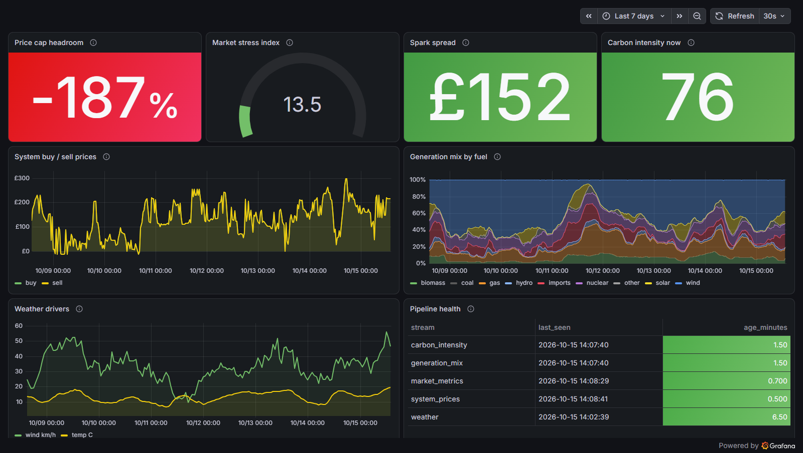
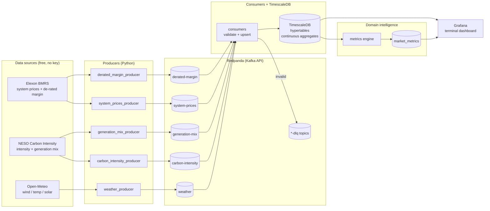
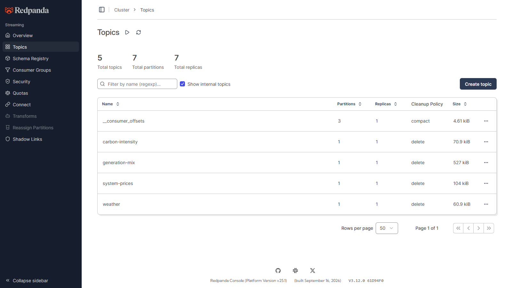
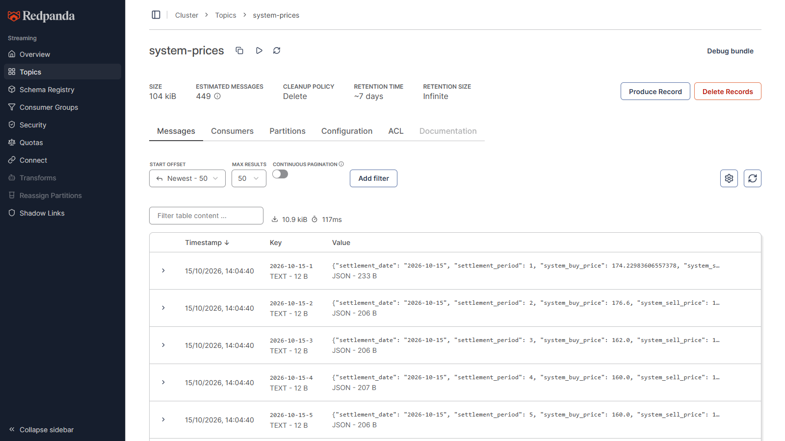
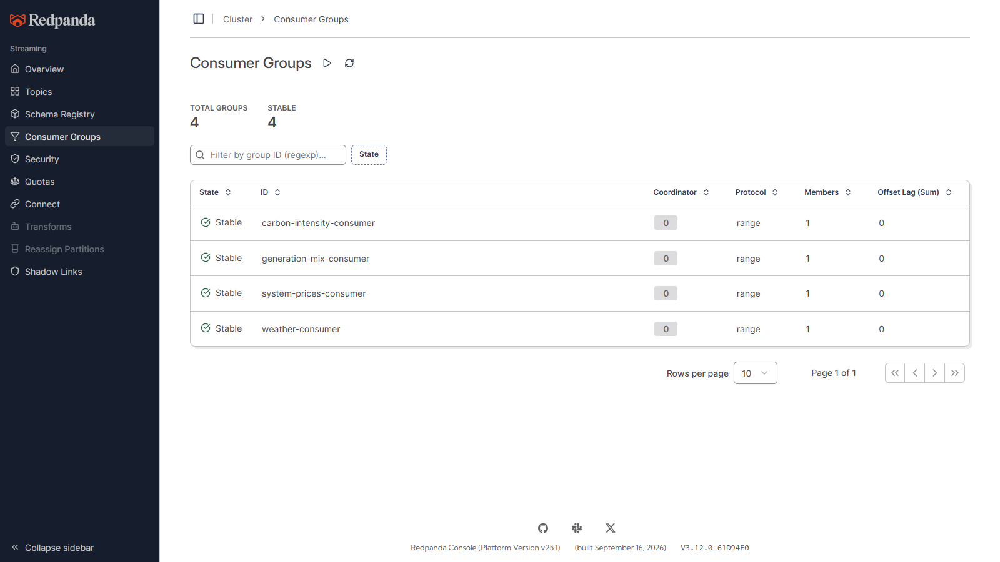

# GridPulse

**Real-time UK energy market intelligence, streamed.**

An open-source energy market monitoring platform streaming UK grid data through Kafka (Redpanda) into TimescaleDB, with a Grafana terminal-style dashboard. Built for data engineers who understand energy markets.



## Overview

GridPulse pulls half-hourly GB settlement prices from Elexon (polled every minute), de-rated margin forecasts from Elexon (every 5 minutes), carbon intensity and generation mix from NESO (every 5 minutes) and weather from Open-Meteo (every 15 minutes). It streams them through Redpanda into TimescaleDB, and every 60 seconds turns them into three commercial signals: **price cap headroom**, a **market stress index** and the **spark spread**. The dashboard is built for supplier risk teams and trading desks. It answers one question: *are we currently buying power for more than the price cap lets us charge for it, and is the grid getting more or less stressed?*

**Proof it runs:** every screenshot in [Screenshots](#screenshots) comes from a live local run against real UK grid data, with all four consumers at zero lag.

---

## The problem

In 2021, 28 retail electricity suppliers went bust because wholesale gas prices spiked 40% above what Ofgem assumed and retail suppliers were forced to absorb the losses because of the price cap for retail prices set by Ofgem based on forward gas prices.

Ofgem sets the maximum unit rate a supplier can charge a household. Inside that unit rate, Ofgem builds in an allowance for what it assumes wholesale electricity costs at the time of setting the cap. That allowance is calculated using forward market prices over a specific observation window, roughly 6 months before the cap period starts. However, Ofgem sets the cap quarterly, but wholesale prices move every single day.

By tracking live wholesale electricity and gas prices against Ofgem's assumed allowance in real time, GridPulse gives suppliers early warning when headroom is eroding -- enabling smarter procurement timing and hedging decisions before losses become irreversible.

---

## Domain intelligence: what makes this different

Most portfolio projects move data from A to B. GridPulse turns volatile market data into commercially meaningful signals -- the numbers energy trading desks actually watch:

### 1. Price cap headroom

How much the price of electricity and gas has changed currently, compared to the predicted price that Ofgem has assumed for suppliers. When headroom goes negative, suppliers buy at market price but can only charge at the cap ceiling -- this single metric predicted every supplier failure in 2021. Displayed as a traffic light: green (headroom > 10%), amber (0-10%), red (negative).

### 2. Market stress index

A composite 0-100 gauge blending four real-time stress signals: de-rated margin tightness (NESO's forecast of spare capacity once every unit is discounted by its expected availability -- the number behind Electricity Margin Notices), Net Imbalance Volume anomalies, 24-hour price volatility, and wind generation shortfall vs baseline. Traders watch these the way equity traders watch volatility indices.

### 3. Spark spread

Electricity price minus gas-to-power cost at typical CCGT efficiency (~49%). Positive spread: gas plants are printing money. Negative: every MWh generated loses money. This is what gas-fired power station operators watch constantly.

---

## Architecture



### Data flow

Each producer polls its API and publishes one JSON message per record to its own Redpanda topic. The message is keyed on the record's natural identity, for example `2026-10-15-27` for settlement period 27. Each consumer validates every message against domain-informed ranges. Valid records are upserted into a TimescaleDB hypertable, so Elexon's retrospective revisions overwrite earlier values instead of duplicating them. Invalid records go to `<topic>-dlq` with the reasons attached. This is the bronze-to-silver step. Every 60 seconds the metrics engine reads the latest silver data and the quarterly Ofgem assumptions in `reference_data`. It runs the pure functions in `metrics/domain.py` and writes the results to `market_metrics`, the gold layer. Grafana reads silver for the charts and gold for the headline signals.

### Stack decisions

| Component | Choice | Why |
|---|---|---|
| Message broker | Redpanda | 100% Kafka API-compatible; 512MB RAM vs Kafka's 2GB+; no ZooKeeper; built-in Schema Registry and web console; starts in seconds |
| Database | TimescaleDB | PostgreSQL extension (zero migration cost); `time_bucket()` for temporal aggregation; continuous aggregates incrementally refresh dashboard views; compression + `drop_chunks()` for retention |
| Dashboard | Grafana | Closest open-source equivalent to a Bloomberg Terminal aesthetic; dark theme, auto-refresh, native time-series support; dashboard defined as code under `grafana/provisioning/` |
| Stream processing | Python consumers | No JVM, no dedicated cluster; pragmatic for a solo developer |
| Deployment | Docker Compose | Single `docker compose up` for the entire stack |

**Rejected alternatives:** Apache Kafka (2GB+ RAM, ZooKeeper, operationally heavy), Kafka Streams (Java-only), Apache Flink (dedicated cluster), plain PostgreSQL (no time-series optimisations).

**Networking note:** Redpanda runs dual listeners -- containers use `redpanda:9092`, host processes use `localhost:19092`.

### Trade-offs and production considerations

**Single broker.** The local stack runs one Redpanda broker with replication factor 1, which keeps the whole platform inside 512MB on a laptop. If that broker dies, ingestion stops and any messages not yet consumed are lost. A production deployment would run a 3-broker cluster with replication factor 3. It would then survive a broker failure without losing data, and consumer groups would rebalance automatically.

**System price as a wholesale proxy.** Headroom and spark spread use the Elexon system (imbalance) price, because it is free and needs no API key. Imbalance prices are far more volatile than the day-ahead and forward prices suppliers actually hedge against. Over the captured week, 77% of settlement periods sat above the assumed allowance, so the headroom light reads red most of the time. That overstates how much stress suppliers are under. In production, headroom would be computed against Elexon Market Index Data or the N2EX day-ahead auction, with the system price kept as a separate scarcity signal.

**Pipelines run on the host.** Producers, consumers and the metrics engine run as eleven separate Python processes on the host machine. That gives fast edit-and-rerun cycles without rebuilding containers. The cost is that nothing restarts a crashed process, and pipeline health only shows a stalled stream after 15 minutes. In production, each would run as its own container with a restart policy (or a Kubernetes Deployment), with liveness probes and alerting on consumer lag.

**Hand-maintained Ofgem assumptions.** Ofgem publishes the cap model as Excel files, not an API, so the allowance, gas price and wind baseline are seeded by hand into `reference_data`. When a new quarter starts and nobody updates them, every headroom figure is quietly wrong. In production, a scheduled job would download and parse each new cap model, and the dashboard would flag reference values older than one quarter.

**JSON without a schema.** Messages are plain JSON, so a field renamed upstream would only surface as a DLQ spike after it happened. Registering Avro schemas in Redpanda's built-in Schema Registry, with backward-compatibility checks, would reject breaking changes when the message is produced instead.

### Data quality and reliability

- **Dead letter queues:** every consumer validates messages against domain-informed ranges (e.g. GB prices can legitimately go negative on windy nights but not to £15,000/MWh). Failures are quarantined to `<topic>-dlq` with their validation errors attached -- visible, never silently dropped.
- **Idempotent writes:** `ON CONFLICT DO UPDATE` everywhere, because Elexon revises settlement data retrospectively and NESO revises forecasts into actuals. Latest value always wins.
- **Continuous aggregates:** hourly/daily rollups refresh incrementally, so dashboards stay fast as history grows.

### Threshold calibration

Every threshold below is checked against the 364 settlement periods captured from 8 to 15 October 2026 (`python scripts/backfill.py`, then SQL over the hypertables):

| Threshold | Value | What the captured week showed | Production approach |
|---|---|---|---|
| Headroom traffic light | red < 0%, amber 0-10%, green > 10% vs a £75/MWh allowance | Sell price ranged from -£13 to £298/MWh (median £129). 77% of periods were above £75 | Compare against day-ahead prices, and refresh the allowance from each quarterly Ofgem cap model |
| Stress: de-rated margin (35% weight) | 0 at 20 GW or more, 100 at 2 GW or less, linear between. 1-hour-ahead BMRS forecast for the period in delivery | Margin ranged 7.1-31.0 GW (median 21.4 GW) over 337 periods. 37% of periods scored above 0, peaking at 72 on the 11 Oct evening peak. Loss of load probability was 0 in every period, so it is stored but not scored. This replaced a buy/sell spread component that always read 0 under single imbalance pricing (P305, 2015) | Calibrate the band per season against winter margins, and blend in LOLP once it starts registering |
| Stress: net imbalance volume (25%, saturates at 3,000 MWh) | \|NIV\| | 95th percentile 629 MWh, maximum 2,366 MWh. The scale is never reached | Use rolling percentiles instead of a fixed ceiling |
| Stress: 24h volatility (25%, saturates at £150) | std dev of sell price | £52 over the last 24h, £69 across the week | Same: a rolling percentile |
| Stress: wind shortfall (15%) | below a 30% baseline | Wind averaged 47.6% of generation (range 4.7-71.1%), so the baseline is set too low for autumn | Use a seasonal baseline or the NESO wind forecast |
| Price validation (DLQ) | -£500 to £9,999/MWh | 11 negative-price periods (minimum -£13.30), all accepted correctly. Zero records went to the DLQ | Keep. Wide enough for scarcity spikes, tight enough to catch unit errors |
| Pipeline freshness | amber 15 min, red 60 min | The slowest feed (weather) polls every 15 minutes, so it is never falsely amber | Set a threshold per stream, based on each source's publishing cadence |

---

## Data sources

| Source | Data | Granularity | Key needed? |
|---|---|---|---|
| Elexon BMRS | System Buy/Sell prices, net imbalance volume | Half-hourly | No |
| Elexon BMRS (LOLPDRM) | De-rated margin + loss of load probability, 1-12 hours ahead | Half-hourly | No |
| NESO Carbon Intensity | GB carbon intensity + generation mix by fuel | Half-hourly | No |
| Open-Meteo | Wind at 100m, temperature, solar radiation | Hourly | No |
| Ofgem | Price cap assumptions (reference data) | Quarterly | N/A -- published as Excel files, seeded into `reference_data` |

---

## Screenshots

All captured from a local run against live, real UK grid data (7-day backfill plus live polling).

### Grafana: the trading-desk view


- **Top row -- the commercial signals.** Price cap headroom (red: suppliers are buying power above what Ofgem's cap assumes), market stress gauge, spark spread (green: gas-fired generation is profitable right now) and live carbon intensity.
- **System buy / sell prices** -- every half-hourly settlement period from Elexon BMRS. Since the 2015 move to a single imbalance price the two lines are identical, so only one is visible. Spikes are grid scarcity events, and the dips below £0 are windy nights.
- **Generation mix** -- share of GB demand met by each fuel, stacked to 100%. Wind-heavy periods (blue) line up with the price troughs on the left -- over the captured week, wind share and system price correlate at -0.52.
- **Weather drivers** -- wind speed at 100m hub height and temperature, the two weather variables that move UK power prices.
- **Pipeline health** -- minutes since each stream last landed a row; amber after 15, red after 60.

### Redpanda Console: the streaming layer

| Topics | Live messages | Consumer groups |
|---|---|---|
|  |  |  |
| One topic per source, 7-day retention. | Real Elexon settlement records, keyed `{date}-{period}` for idempotent upserts. | All four consumers stable with **zero offset lag** -- everything produced has landed in TimescaleDB. |

---

## Getting started

### Prerequisites

- **Docker Desktop** (with Docker Compose v2)
- **Python** 3.12+
- About 2GB of free RAM for the stack

### Quick start (Windows PowerShell)

1. Clone, configure and install:
   ```powershell
   git clone https://github.com/nse4real/gridpulse.git
   cd gridpulse
   cp .env.example .env   # fill in values
   python -m venv venv
   venv\Scripts\activate
   pip install -r requirements.txt
   ```

2. Start Redpanda, TimescaleDB, Grafana and Redpanda Console:
   ```powershell
   docker compose up -d
   ```
   Wait about 20 seconds for TimescaleDB to accept connections.

3. Seed the Ofgem reference data and continuous aggregates (one-time setup):
   ```powershell
   type sql\001_reference_data.sql | docker exec -i timescaledb psql -U gridpulse -d gridpulse
   type sql\002_continuous_aggregates.sql | docker exec -i timescaledb psql -U gridpulse -d gridpulse
   ```

4. Load the last 7 days of history so the charts have something to show (one-time setup):
   ```powershell
   python scripts/backfill.py
   ```
   You should see about 360 system-price, 1,700 de-rated-margin, 340 carbon-intensity, 3,000 generation-mix and 190 weather records produced.

5. Start the consumers (each in its own terminal). They land the backfill straight away:
   ```powershell
   python consumers/system_prices_consumer.py
   python consumers/derated_margin_consumer.py
   python consumers/carbon_intensity_consumer.py
   python consumers/generation_mix_consumer.py
   python consumers/weather_consumer.py
   ```

6. Start the live producers and the metrics engine (each in its own terminal):
   ```powershell
   python producers/system_prices_producer.py
   python producers/derated_margin_producer.py
   python producers/carbon_intensity_producer.py
   python producers/generation_mix_producer.py
   python producers/weather_producer.py
   python metrics/calculator.py
   ```

7. Open the dashboards:

   | Surface | URL | What you should see |
   |---|---|---|
   | Grafana | http://localhost:3000 | The GridPulse dashboard, with all 8 panels populated |
   | Redpanda Console | http://localhost:8080 | 5 topics. Under Consumer Groups, 5 stable groups with zero lag |

**Note:** step 4 is optional but recommended. Without it, the live producers only fetch the current day, so the charts build up history slowly.

Run the tests:

```powershell
python -m pytest tests/ -v
```

Or use the Makefile shortcuts (`make up`, `make backfill`, `make test`, `make metrics`).

---

## Repo structure

```
gridpulse/
├── producers/          # API -> Redpanda, one per data source
├── consumers/          # Redpanda -> TimescaleDB, with validation + DLQ
├── metrics/            # Domain intelligence engine (headroom, stress, spark spread)
├── scripts/            # One-off utilities (7-day history backfill)
├── common/             # Shared validation rules and DLQ helper
├── sql/                # Reference data seeds + continuous aggregates
├── grafana/            # Datasource and dashboard provisioning (dashboard as code)
├── docs/screenshots/   # README images
├── tests/              # Unit tests for validation and domain maths
├── docker-compose.yml
└── Makefile
```

---

## Known gaps and future improvements

- **No day-ahead price feed.** Headroom is measured against volatile imbalance prices, so it overstates supplier stress. Next step: Elexon Market Index Data, or ENTSO-E day-ahead prices once an API token arrives.
- **Stress thresholds are fixed, not seasonal.** The de-rated margin band (20 GW to 2 GW) and the NIV and volatility ceilings were set from one October week, and LOLP is stored but not yet scored because it read 0 in every period. Next step: rolling percentiles per season, and blend LOLP into the margin component once winter data shows it moving.
- **No process supervision.** A crashed producer or consumer stays down until someone notices it on the pipeline health panel. Next step: containerise the pipelines with restart policies and alert on consumer lag.
- **No CI.** The 37 domain and validation tests only run when someone remembers to run them, so a regression in the headroom maths could ship silently. Next step: a GitHub Actions workflow on every push.
- **No schema enforcement.** An upstream field rename would only be caught after the fact, in the DLQ. Next step: Avro schemas in Redpanda's Schema Registry.
- **No what-if tooling.** Suppliers can't yet test how headroom would move under a different cap or gas price. Next step: a Streamlit scenario explorer.

## Licence

MIT
