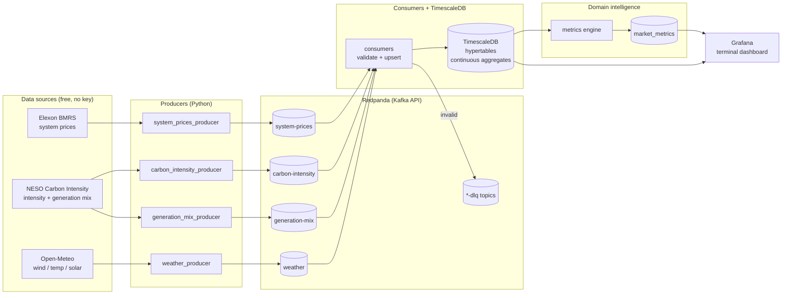

# GridPulse

**Real-time UK energy market intelligence, streamed.**

An open-source energy market monitoring platform streaming UK grid data through Kafka (Redpanda) into TimescaleDB, with a Grafana terminal-style dashboard. Built for data engineers who understand energy markets.


---

## The problem

In 2021, 28 retail electricity suppliers went bust because wholesale gas prices spiked 40% above what Ofgem assumed and retail suppliers were forced to absorb the losses because of the price cap for retail prices set by Ofgem based on forward gas prices.

Ofgem sets the maximum unit rate a supplier can charge a household. Inside that unit rate, Ofgem builds in an allowance for what it assumes wholesale electricity costs at the time of setting the cap. That allowance is calculated using forward market prices over a specific observation window, roughly 6 months before the cap period starts. However, Ofgem sets the cap quarterly, but wholesale prices move every single day.

By tracking live wholesale electricity and gas prices against Ofgem's assumed allowance in real time, GridPulse gives suppliers early warning when headroom is eroding -- enabling smarter procurement timing and hedging decisions before losses become irreversible.

---

## Domain intelligence: what makes this different

Most portfolio projects move data from A to B. GridPulse turns volatile market data into commercially meaningful signals -- the numbers energy trading desks actually watch:

### 1. Price cap headroom

How much the price of electricity and gas has changed currently, compared to the predicted price that Ofgem has assumed for suppliers. When headroom goes negative, suppliers buy at market price but can only charge at the cap ceiling -- this single metric predicted every supplier failure in 2021. Displayed as a traffic light: green (headroom > 10%), amber (0-10%), red (negative).

### 2. Market stress index

A composite 0-100 gauge blending four real-time stress signals: System Buy/Sell spread (National Grid ESO paying a premium for power = scarcity), Net Imbalance Volume anomalies, 24-hour price volatility, and wind generation shortfall vs baseline. Traders watch these the way equity traders watch volatility indices.

### 3. Spark spread

Electricity price minus gas-to-power cost at typical CCGT efficiency (~49%). Positive spread: gas plants are printing money. Negative: every MWh generated loses money. This is what gas-fired power station operators watch constantly.

---

## Architecture



### Stack decisions and trade-offs

| Component | Choice | Why |
|---|---|---|
| Message broker | Redpanda | 100% Kafka API-compatible; 512MB RAM vs Kafka's 2GB+; no ZooKeeper; built-in Schema Registry and web console; starts in seconds |
| Database | TimescaleDB | PostgreSQL extension (zero migration cost); `time_bucket()` for temporal aggregation; continuous aggregates incrementally refresh dashboard views; compression + `drop_chunks()` for retention |
| Dashboard | Grafana | Closest open-source equivalent to a Bloomberg Terminal aesthetic; dark theme, auto-refresh, native time-series support; dashboard defined as code under `grafana/provisioning/` |
| Stream processing | Python consumers | No JVM, no dedicated cluster; pragmatic for a solo developer |
| Deployment | Docker Compose | Single `docker compose up` for the entire stack |

**Rejected alternatives:** Apache Kafka (2GB+ RAM, ZooKeeper, operationally heavy), Kafka Streams (Java-only), Apache Flink (dedicated cluster), plain PostgreSQL (no time-series optimisations).

**Networking note:** Redpanda runs dual listeners -- containers use `redpanda:9092`, host processes use `localhost:19092`.

### Data quality and reliability

- **Dead letter queues:** every consumer validates messages against domain-informed ranges (e.g. GB prices can legitimately go negative on windy nights but not to £15,000/MWh). Failures are quarantined to `<topic>-dlq` with their validation errors attached -- visible, never silently dropped.
- **Idempotent writes:** `ON CONFLICT DO UPDATE` everywhere, because Elexon revises settlement data retrospectively and NESO revises forecasts into actuals. Latest value always wins.
- **Continuous aggregates:** hourly/daily rollups refresh incrementally, so dashboards stay fast as history grows.

---

## Data sources

| Source | Data | Granularity | Key needed? |
|---|---|---|---|
| Elexon BMRS | System Buy/Sell prices, net imbalance volume | Half-hourly | No |
| NESO Carbon Intensity | GB carbon intensity + generation mix by fuel | Half-hourly | No |
| Open-Meteo | Wind at 100m, temperature, solar radiation | Hourly | No |
| Ofgem | Price cap assumptions (reference data) | Quarterly | N/A -- published as Excel files, seeded into `reference_data` |

---

## Screenshots

All captured from a local run against live, real UK grid data (7-day backfill plus live polling).

### Grafana: the trading-desk view


- **Top row -- the commercial signals.** Price cap headroom (red: suppliers are buying power above what Ofgem's cap assumes), market stress gauge, spark spread (green: gas-fired generation is profitable right now) and live carbon intensity.
- **System buy / sell prices** -- every half-hourly settlement period from Elexon BMRS. Since the 2015 move to a single imbalance price the two lines usually coincide; spikes are grid scarcity events.
- **Generation mix** -- share of GB demand met by each fuel, stacked to 100%. Wind-heavy periods (blue) line up with the price troughs on the left -- over the captured week, wind share and system price correlate at -0.52.
- **Weather drivers** -- wind speed at 100m hub height and temperature, the two weather variables that move UK power prices.
- **Pipeline health** -- minutes since each stream last landed a row; amber after 15, red after 60.

### Redpanda Console: the streaming layer

| Topics | Live messages | Consumer groups |
|---|---|---|
|  |  |  |
| One topic per source, 7-day retention. | Real Elexon settlement records, keyed `{date}-{period}` for idempotent upserts. | All four consumers stable with **zero offset lag** -- everything produced has landed in TimescaleDB. |

---

## Getting started

**Prerequisites:** Docker Desktop, Python 3.12+.

```powershell
git clone https://github.com/nse4real/gridpulse.git
cd gridpulse
cp .env.example .env   # fill in values
python -m venv venv
venv\Scripts\activate
pip install -r requirements.txt

# Start Redpanda, TimescaleDB, Grafana
docker compose up -d

# Seed reference data and continuous aggregates
type sql\001_reference_data.sql | docker exec -i timescaledb psql -U gridpulse -d gridpulse
type sql\002_continuous_aggregates.sql | docker exec -i timescaledb psql -U gridpulse -d gridpulse

# Optional: backfill the last 7 days so the charts have history
python scripts/backfill.py

# Run pipelines (each in its own terminal)
python producers/system_prices_producer.py
python producers/carbon_intensity_producer.py
python producers/generation_mix_producer.py
python producers/weather_producer.py
python consumers/system_prices_consumer.py
python consumers/carbon_intensity_consumer.py
python consumers/generation_mix_consumer.py
python consumers/weather_consumer.py
python metrics/calculator.py
```

Then open:

| Surface | URL |
|---|---|
| Grafana dashboard | http://localhost:3000 |
| Redpanda Console (topics, DLQ inspection) | http://localhost:8080 |

Run the tests:

```powershell
python -m pytest tests/ -v
```

Or use the Makefile shortcuts (`make up`, `make test`, `make metrics`).

---

## Repo structure

```
gridpulse/
├── producers/          # API -> Redpanda, one per data source
├── consumers/          # Redpanda -> TimescaleDB, with validation + DLQ
├── metrics/            # Domain intelligence engine (headroom, stress, spark spread)
├── scripts/            # One-off utilities (7-day history backfill)
├── common/             # Shared validation rules and DLQ helper
├── sql/                # Reference data seeds + continuous aggregates
├── grafana/            # Datasource and dashboard provisioning (dashboard as code)
├── docs/screenshots/   # README images
├── tests/              # Unit tests for validation and domain maths
├── docker-compose.yml
└── Makefile
```

---

## Roadmap

- [ ] ENTSO-E producer (pan-European prices, interconnector flows) -- needs API token
- [ ] Elexon Market Index Data for true day-ahead wholesale prices (headroom currently uses system sell price as a documented proxy)
- [ ] Avro serialisation via Redpanda's built-in Schema Registry
- [ ] GitHub Actions CI running the data-quality test suite on every push
- [ ] Streamlit what-if explorer for price cap scenarios

## Licence

MIT
